<!--
  This file only shows on your profile if the repository is named EXACTLY: ajayyadavmit  (public, with this README.md at the root)

1. On GitHub, create a public repository named exactly ajayyadavmit and tick "Add a README".
2. Upload README.md (replacing the default one) and the assets folder with both SVG files.
3. Open github.com/ajayyadavmit to see it.
4. pin your best six repositories using "Customize your pins".
-->

  

<b>🟢 Open to teacher training, curriculum research &amp; EdTech collaboration</b>

  
  
  

---

## 👋 About me

I research and design **Computer Science curriculum for PK–12**, manage **EdTech  projects**, and train educators to use **AI responsibly in the classroom**.

- 🎓 **Research focus:** CS curriculum design, standards alignment, assessment and teacher professional development
- 🤖 **AI education:** trained: school teachers, faculty and government education teams
- 💼 **Project management:** EdTech products, from idea and roadmap to delivery

---

## 🧭 What I do

| Area | What it looks like in practice |
|---|---|
| **CS curriculum PK–12** | Scope and sequence, competency maps, lesson and assessment design |
| **AI for educators** | Hands-on workshops and multi-day programmes for teachers and academic leaders |
| **EdTech and FinTech delivery** | Product requirements, roadmaps, stakeholder updates, sprint planning |
| **Research and writing** | Training reports, project findings, lessons learned, practitioner blogs |

---

## 🛠️ Featured work

<!-- REPLACE each YOUR-REPO-NAME with the real repository name, then pin these on your profile -->

| Project | What it is |
|---|---|
| [**CS & AI Education Digest**](https://github.com/ajayyadavmit/YOUR-REPO-NAME) | A daily digest of CS and AI education articles, refreshed automatically with GitHub Actions |
| [**Word Completion Game**](https://github.com/ajayyadavmit/YOUR-REPO-NAME) | A browser game that teaches spelling and vocabulary (A\_\_LE → APPLE), built with HTML, JSON data and GitHub Pages |
| [**AI for Educators course**](https://github.com/ajayyadavmit/YOUR-REPO-NAME) | A 2-day training plan for primary and secondary teachers, with materials and outcomes |

---

## 🧰 Tools and topics

---

  

